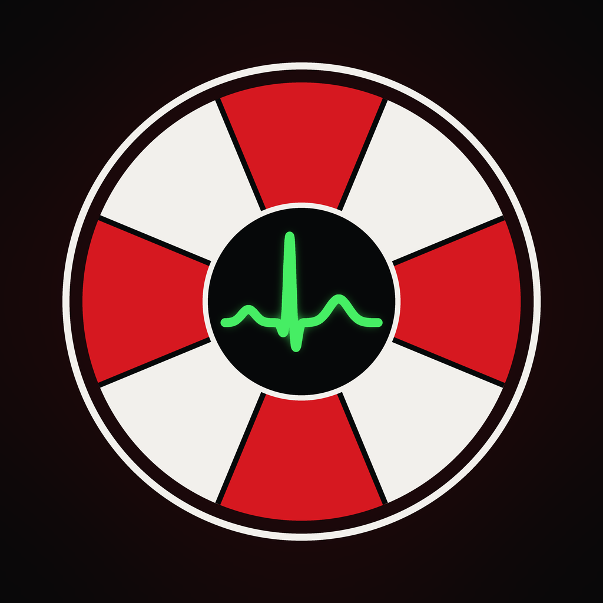
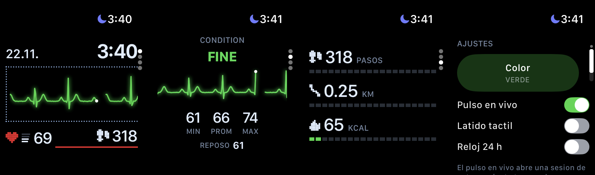

<p align="center"></p>

<h1 align="center">Biomonitor</h1>

Monitor de pulso para Apple Watch inspirado en el reloj que usa Ethan Winters en *Resident Evil 7*. Muestra el pulso en vivo, un trazo de ECG que barre la pantalla y los datos del día con la misma estética: marco punteado, tipografía condensada e iconos de píxeles.

<p align="center"></p>

## Funciones

- **Monitor.** Fecha y hora, trazo de ECG en marco punteado, pulso con barras de zona y pasos. Tocar la gráfica alterna entre el ECG y el historial de pulso en escalones.
- **Condition.** Estado FINE, CAUTION o DANGER (BIEN, PRECAUCIÓN, PELIGRO en español) según el pulso, con mínimo, promedio, máximo y pulso en reposo del día.
- **Actividad.** Pasos, distancia y energía activa con barras segmentadas hacia una meta.
- **Ajustes.** Paleta verde (marco punteado) o cian (barras azules como la pantalla del genoma), pulso en vivo, latido táctil (lub-dub) y reloj de 24 h.
- **Animaciones.** Secuencia de arranque, marco que se dibuja solo, corazón que late con el pico R del ECG, estela de fósforo en el trazo, líneas de barrido tipo CRT, interferencia al cambiar de página y marco de estado que late más rápido en CAUTION y DANGER, con háptico al cambiar de estado.
- **Navegación propia.** Desliza a los lados o gira la corona; la barra superior muestra la página y cuatro segmentos, sin los puntos del sistema.
- **Idioma.** Español e inglés, elegible en Ajustes (por defecto el del sistema).
- **Sonido.** Tonos sintetizados al vuelo (arranque, páginas, alertas de estado y bip opcional con cada latido), sin archivos de audio.
- **Detalles de la saga.** Emblema de Umbrella en el arranque y recomendación de objeto según el estado: hierba verde en CAUTION, botiquín en DANGER.
- **Siempre activa.** Con la pantalla atenuada el trazo se congela y baja el brillo.

## Cómo funciona

El pulso en vivo se lee con una sesión de entrenamiento temporal (`HKWorkoutSession`) que se descarta al terminar, por lo que no se escribe nada en Salud. Pasos, distancia, energía y estadísticas de pulso salen de consultas a HealthKit.

La onda del ECG es **sintética** (ondas P, QRS y T) y su frecuencia sigue el pulso medido. No es un electrocardiograma y la app no es un dispositivo médico.

Umbrales de estado: FINE por debajo de 120 lpm, CAUTION de 120 a 159, DANGER desde 160 o por debajo de 40.

## Requisitos

- Apple Watch con watchOS 10 o superior
- Xcode 15 o superior y [XcodeGen](https://github.com/yonaskolb/XcodeGen) (`brew install xcodegen`)
- Un equipo de desarrollo de Apple (sirve la cuenta gratuita)

## Instalación

```bash
git clone <url-del-repo> && cd biomonitor
TEAM_ID=XXXXXXXXXX ./scripts/install-watch.sh
```

El script genera el proyecto, compila en Release, firma con tu equipo e instala en el primer Apple Watch emparejado. Con una cuenta gratuita el perfil caduca a los 7 días y hay un máximo de 3 apps instaladas por reloj; vuelve a ejecutar el script para renovar.

## Estructura

```
Biomonitor/
  Model/   Vitals (datos, estados, paletas), ECGEngine (trazo), VitalsModel (HealthKit), Lang (idiomas), SoundFX (audio)
  Views/   MonitorView, StatusViews, ChartViews, Effects, NavBar, Pixel, SettingsView
scripts/
  install-watch.sh   compila, firma e instala en el reloj
  make-icon.py       genera el icono de 1024 px
```

El icono (`docs/icono.png`, generado con `scripts/make-icon.py`) muestra el emblema rojo y blanco de Umbrella con un pulso verde en el centro.

## Aviso

Proyecto de aficionado sin relación con Capcom. *Resident Evil* y el emblema de Umbrella son marcas de Capcom Co., Ltd.

## Licencia

MIT
